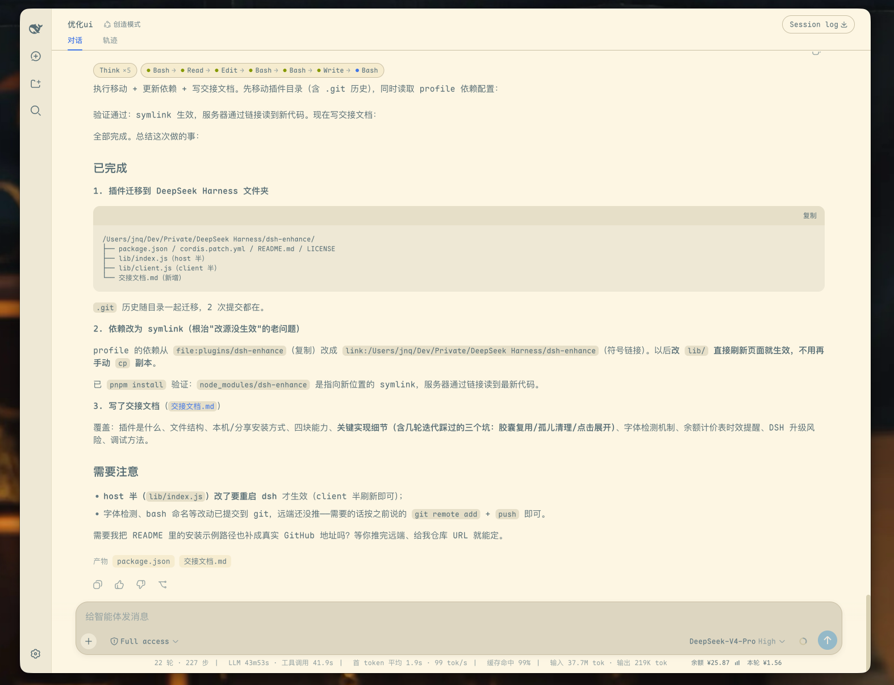
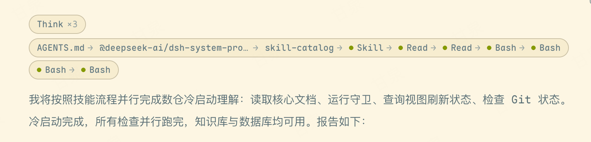

# dsh-ux

[](https://dsh.directory/plugins/jiangnanquan/dsh-ux)

[中文](README.md) | **English**

A UI enhancement suite for DeepSeek Harness (DSH) Web, consisting of two parts:

| Component | Description |
|-----------|-------------|
| **dsh-enhance** (repository root) | DSH plugin for a settings page with instant toggles, theming, layout, collapsible capsules, and usage information; installs into both the web profile and the official desktop app |
| ~~**dsh-desktop** (`desktop/`)~~ | ~~Frameless Electron desktop shell~~ **Deprecated**: the official desktop app ships its own shell |



## Features (dsh-enhance)

| Category | Description |
|----------|-------------|
| Settings page | Its own page in the settings panel's left rail ("Interface" / 界面增强): one switch per feature, applied **instantly** — no restart |
| Typography | CJK-first 0.5-narrow monospace schemes (Sarasa Mono/Term SC, Noto Sans Mono CJK…), plus a weight switch — see below |
| Theme | Solarized light palette (the official dark theme is preserved) |
| Layout | Wider message column, tighter spacing, a compact composer dock, and disabled rubber-band scrolling |
| Collapsible capsules | 0.1.x: aggregates reasoning blocks into a `Think ×N` capsule and tool calls into an `A → B → C` chain, click to expand. 0.2.0: the official process-group folding owns visibility; the plugin attaches the capsule summary below the visible "Completed, took X" row and clicking it toggles the official disclosure; long chains wrap by available width, one capsule per visual line |
| Usage information | Shows the official account balance, estimated cost for the current session, and a local 30-day usage chart in the footer |

Long tool chains automatically reflow with the message column while preserving a complete, independent capsule around each visual line:



## Typography: CJK-first and 0.5-narrow Latin

Based on *Terminal Typography Philosophy: CJK-First and the 0.5 Narrow Monospace Practice* (measured data below):

**A Han character is an uncompromisable 1.0 square.** For "2 Latin characters = 1 Han character" to hold
exactly, the Latin advance must be narrowed to **0.5**. Latin-first programming fonts (Menlo, JetBrains Mono,
Fira Code, Maple Mono…) sit at 0.6–0.67, which stretches the Han container to 1.2 — Han glyphs are either
widened by 20% (squat, counters collapsed) or surrounded by dead space.

Measured with CoreText on this machine (unitsPerEm=1000, glyph advance widths):

| Family | Latin `a` | Han `中` | Ratio | `—` | `→` | `★` |
|--------|-----------|----------|-------|-----|-----|-----|
| **Sarasa Mono SC** | 0.500 | 1.000 | **2.000** | 1.000 | 1.000 | 1.000 |
| **Sarasa Term SC** | 0.500 | 1.000 | **2.000** | 0.500 | 0.500 | 0.500 |
| Noto Sans Mono CJK SC | 0.500 | 1.000 | **2.000** | 0.894 | 1.000 | 1.000 |
| Sarasa Gothic / UI SC | 0.562 | 1.000 | 1.78 | 1.000 | 0.954 | 1.045 |
| Maple Mono NF CN | 0.600 | **1.200** | 2.000 | 0.600 | 0.600 | — |
| Maple Mono (non-CN) | 0.600 | no glyphs | — | 0.600 | 0.600 | — |

Sarasa Gothic is built exactly on that philosophy: Iosevka Latin (a strict 0.5) plus Source Han Sans Han
glyphs (1.0), with baselines, x-height and weight curves aligned at the pixel level. **The only difference
between Mono and Term is the East Asian ambiguous-width set** (—……→★■●): Mono keeps them full-width (best for
reading Markdown and Chinese punctuation), Term squeezes them to half-width (best for dense grids and cursor
movement). Maple Mono NF CN is the very case the article warns about — its Han glyphs are stretched to 1.2.

Available schemes in the settings page:

| Scheme | Notes |
|--------|-------|
| Auto (recommended) | Tries, in order: Sarasa Mono SC → Sarasa Term SC → Noto Mono CJK → Maple Mono; falls back to the official stack when none is installed |
| Sarasa Mono SC | 0.5 narrow Latin, full-width ambiguous characters |
| Sarasa Term SC | 0.5 narrow Latin, half-width ambiguous characters |
| Noto Mono CJK | Noto Sans Mono CJK SC, also 0.5/1.0 |
| Maple Mono | Legacy look (Latin 0.6 / Han 1.2), kept for compatibility |
| Off | Leaves the official font stack untouched |

Installed families are probed live and shown on the page (unavailable schemes are greyed out; install the
font and come back — no restart). A separate **weight** switch offers *Standard* and *SemiBold*: SemiBold
lifts body text to 600 and emphasis to 700 using the family's real vector SemiBold (the article's sweet
spot), and both modes set `font-synthesis: none` — the CSS equivalent of the article's "no algorithmic fake
bold", which smears counters and glues strokes together.

The page also carries an **alignment self-test block** (the article's §5 text, re-padded so the columns line
up): line 1's 40 half-width characters must be exactly as wide as line 2's 20 Han characters, and the box
must render as a rectangle. If they do, the scheme is right.

Rationale, measurements and how to add another family: [docs/字体方案-中文优先与0.5窄体.md](docs/字体方案-中文优先与0.5窄体.md) (Chinese).

## Settings (instant toggles)

Open **Settings → 界面增强** (Interface). That page holds every switch the plugin owns:

| Switch | What turning it off does |
|--------|--------------------------|
| Enable dsh-ux enhancements | Master switch. The whole layer is removed immediately and the official look is restored; per-feature choices are remembered and come back when you re-enable it |
| Font scheme / weight | Back to the official font stack and weights; setting the scheme to "Off" disables just the typography layer |
| Solarized warm palette | Back to the official light palette (dark mode always uses the official one) |
| Compact layout tweaks | Message width, spacing, and composer-card alignment return to the official geometry |
| Collapsible capsules | Reasoning and tool calls expand inline again, and the injected capsule nodes are removed from the DOM |
| Balance and usage | The balance/current-cost row and chart disappear, and the balance endpoint is no longer polled |
| Diagnostic log | Stops the `[dsh-enhance-diag]` console line printed every 5 seconds |

**Everything applies instantly; nothing needs a restart.** Switches are projected onto `data-dsh-ux-*`
attributes on `<html>` (the CSS gates) and persisted in a cookie so the host half can restore them before
the first paint (otherwise the official palette would flash for one frame).

The only restart case is **updating the plugin itself**: the client half is replaced by a page reload or
client hot reload, while the host half (the `/enh/*` endpoints and the first-paint injection) is loaded by
the dsh process at startup and cannot be swapped live. The settings page compares the two builds and, when
they differ, says so plainly ("restart DeepSeek Harness to take effect") and offers a re-check button. That
is what `GET /enh/ping` is for.

The old "dsh-ux 配色" row used to occupy a row inside the official **General** section; it has moved onto
this page. A legacy theme cookie is recognized and cleared on the first write.

## Installation

Prerequisite: DSH is already running through its profile mechanism (`dsh web`).

```bash
dsh plugin --profile web add github:jiangnanquan/dsh-ux#main
```

The package declares both `dsh.bundle.patch` and `dsh.client`. `dsh plugin add` automatically adds the plugin to the profile bundle list. **Restart DSH to activate it**; no manual configuration edits are required. Running the installation command again is safe and idempotent. To update, run `dsh plugin --profile web update dsh-enhance`.

> **The official desktop app does not use this command**: the `desktop` profile is owned exclusively by the Electron application and `dsh plugin --profile desktop …` is rejected outright. See [INSTALL.md](INSTALL.md) for the desktop path.

## Hand It to Your AI Agent

If you prefer not to run the commands manually, paste the following prompt into any AI coding agent (Claude Code, DSH, Gemini CLI, and others) and ask it to follow `INSTALL.md`:

> Follow the instructions in https://github.com/jiangnanquan/dsh-ux/blob/main/INSTALL.md to install and verify the dsh-enhance plugin on my machine using the web profile. Run the documented health checks and report the results. If any step fails, follow the rollback instructions and explain the cause.

## Desktop App (dsh-desktop)

The official desktop app bundles its own dsh runtime and Electron shell (`@deepseek-ai/dsh-desktop-host`) and uses a dedicated `desktop` profile (`~/.dsh/profiles/desktop`, listening on `127.0.0.1:19387`). Installing there differs from the web profile; see [INSTALL.md](INSTALL.md).

> **The `desktop/` directory in this repository (the lightweight dsh-desktop wrapper) is deprecated.** The official shell already covers everything it did — frameless window, backend startup, authentication. It no longer needs to be installed and is kept for historical reference only.

## Requirements and Notes (dsh-enhance)

- **Font:** installing **Sarasa Gothic** (`Sarasa-SuperTTC`, or the individual `Sarasa Term/Mono SC` weights) is recommended — it is the one free family that satisfies both "0.5 narrow Latin" and "1.0 square Han" with aligned weight curves. Without it, [Noto Sans Mono CJK SC](https://github.com/notofonts/noto-cjk) also measures 0.5/1.0 but ships only Regular/Bold, and [Maple Mono](https://github.com/subframe7536/maple-font) (Latin 0.6, Han 1.2) remains available as the legacy look. When none is installed the typography layer falls back to the official stack without affecting anything else.
- **Balance, current-session cost, and usage chart:** These features call the official DeepSeek API and require `DEEPSEEK_API_KEY` to be configured in DSH. If credentials are unavailable, the fields show an unavailable or failed state without affecting the other features.
- The pricing table is hard-coded in `pricingFor` inside `lib/index.js` using official peak and off-peak rates (peak hours in Beijing time: 09:00–12:00 and 14:00–18:00; half price at other times). Update it if DeepSeek changes its pricing.

## Uninstallation

```bash
dsh plugin --profile web remove dsh-enhance
```

## License

MIT
